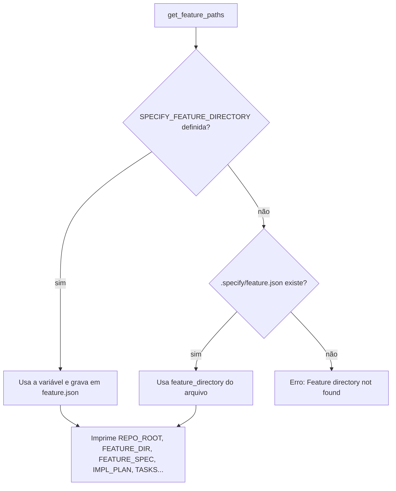
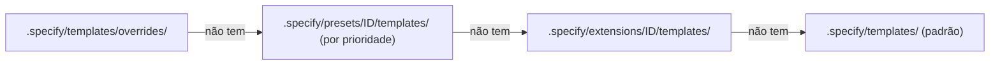
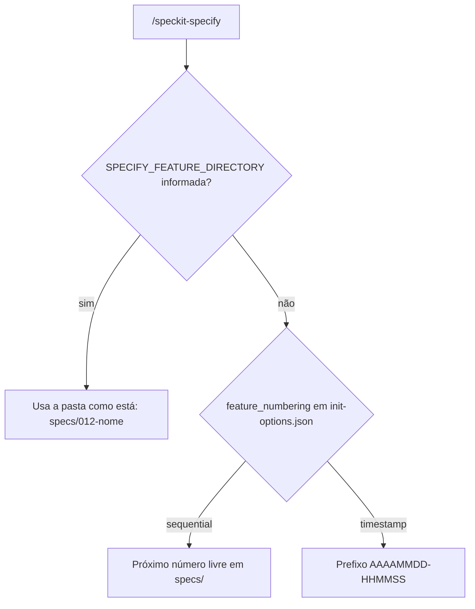
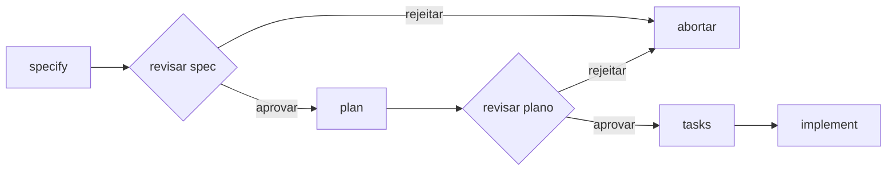
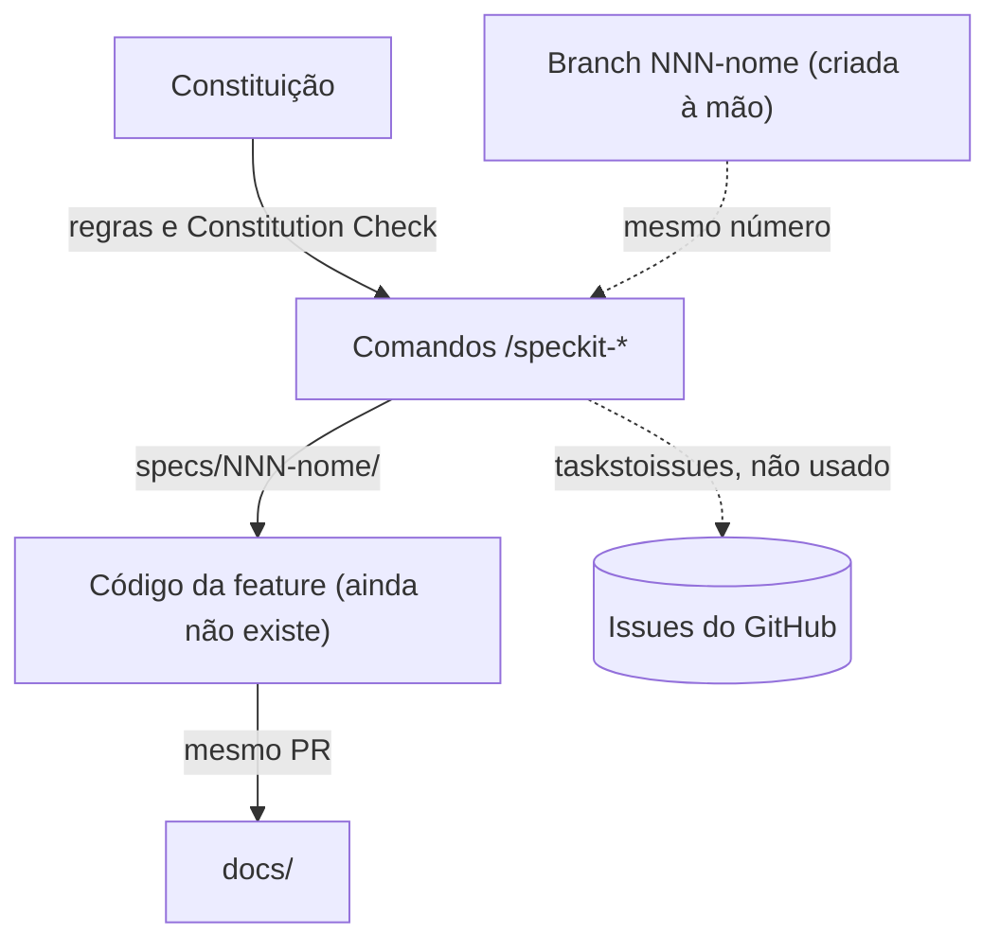

# Ferramentas de SDD (spec-kit)

## Visão geral

O spec-kit é o "cartório" do projeto. Antes de alguém construir qualquer coisa, ele registra o pedido num formulário padrão (a spec), carimba o plano de construção (o plano) e emite a lista de serviços (as tarefas). Cada formulário ganha um número e uma pasta própria, para que dê para achar depois quem pediu o quê e por quê.

Na prática, são comandos digitados no Claude Code (`/speckit-specify`, `/speckit-plan`…). Cada um lê as regras do projeto, usa um modelo de documento e grava o resultado em `specs/NNN-nome/`. Por baixo, alguns scripts bash descobrem qual é a feature atual e qual modelo usar.

Este módulo não roda em produção: é ferramenta de desenvolvimento. Foi instalado com o [spec-kit](https://github.com/github/spec-kit) 1.1.1 (`1.1.1.dev0`), integração `claude`, scripts `sh`.

## Responsabilidades

- Criar a pasta e a spec de cada feature, a partir do modelo.
- Guardar qual é a feature atual (`.specify/feature.json`).
- Copiar o modelo de plano e entregar o modelo de tarefas.
- Conferir se os artefatos exigidos por cada etapa existem.
- Escolher o modelo de documento certo entre substituições, presets, extensões e o padrão.
- Disponibilizar a constituição a todos os comandos.

## Estrutura de arquivos

| Arquivo | Papel |
|---|---|
| `.specify/memory/constitution.md` | Constituição do projeto, lida por `/speckit-plan` (Constitution Check), `/speckit-analyze` e outros |
| `.specify/memory/.constitution-template.json` | Hash e origem do modelo de constituição |
| `.specify/templates/spec-template.md` | Modelo da spec: histórias de usuário, requisitos, critérios de sucesso e premissas |
| `.specify/templates/plan-template.md` | Modelo do plano: contexto técnico, Constitution Check, estrutura do projeto e Complexity Tracking |
| `.specify/templates/tasks-template.md` | Modelo das tarefas: fases Setup, Foundational, uma por história e Polish |
| `.specify/templates/checklist-template.md` | Modelo de checklist |
| `.specify/templates/constitution-template.md` | Modelo de constituição (com marcadores) |
| `.specify/scripts/bash/common.sh` | Funções compartilhadas: raiz do projeto, feature atual, caminhos e resolução de modelos |
| `.specify/scripts/bash/create-new-feature.sh` | Cria a pasta e a spec de uma feature com número; útil à mão (os comandos não o chamam) |
| `.specify/scripts/bash/check-prerequisites.sh` | Confere os artefatos exigidos por uma etapa e lista os disponíveis |
| `.specify/scripts/bash/setup-plan.sh` | Cria a pasta da feature e copia o modelo de plano |
| `.specify/scripts/bash/setup-tasks.sh` | Exige plano e spec, lista os anexos e entrega o modelo de tarefas |
| `.specify/scripts/bash/resolve-template.sh` | Imprime o conteúdo resolvido de um modelo |
| `.specify/workflows/speckit/workflow.yml` | Fluxo automático specify → plan → tasks → implement com revisões entre as etapas |
| `.specify/workflows/workflow-registry.json` | Registro dos fluxos instalados |
| `.specify/init-options.json` | Opções de instalação (`feature_numbering: sequential`, `script: sh`) |
| `.specify/integration.json` | Integração `claude`, com separador `-` nos nomes dos comandos |
| `.specify/integrations/claude.manifest.json` | Hash de cada `SKILL.md` instalado |
| `.specify/integrations/speckit.manifest.json` | Hash de cada script e modelo instalado |
| `.specify/.gitignore` | Ignora `feature.json` e configurações locais de extensões |
| `.claude/skills/speckit-*/SKILL.md` | Os dez comandos (tabela abaixo) |

## Modelos e estado

O módulo não tem tabelas de banco. Ele guarda estado em arquivos:

| Arquivo | Versionado | Conteúdo |
|---|---|---|
| `.specify/feature.json` | Não (`.specify/.gitignore:6`) | `{"feature_directory": "specs/NNN-nome"}`: a feature atual desta cópia do repositório |
| `specs/NNN-nome/` | Sim | Os artefatos da feature (lista em [workflow.md](../workflow.md#artefatos-de-cada-feature)) |

## Comandos

Os comandos fazem o papel das rotas deste módulo. Cada um é um `SKILL.md` executado pelo Claude Code.

| Comando | Script chamado | O que faz | Exige |
|---|---|---|---|
| `/speckit-constitution` | `resolve-template.sh constitution-template --json` | Cria ou emenda a constituição | — |
| `/speckit-specify` | Nenhum (o próprio comando cria a pasta) | Cria `spec.md`, `checklists/requirements.md` e grava `feature.json` | — |
| `/speckit-clarify` | `check-prerequisites.sh --json --paths-only` | Faz até 5 perguntas e grava as respostas na spec | `feature.json` ou `SPECIFY_FEATURE_DIRECTORY` |
| `/speckit-plan` | `setup-plan.sh --json` | Gera o plano e seus anexos | Feature atual |
| `/speckit-checklist` | `check-prerequisites.sh --json --template` | Gera um checklist sob medida | `plan.md` |
| `/speckit-tasks` | `setup-tasks.sh --json` | Gera `tasks.md` | `plan.md` e `spec.md` |
| `/speckit-analyze` | `check-prerequisites.sh --json --require-spec --require-tasks --include-tasks` | Relatório de consistência; não altera arquivos | `plan.md`, `spec.md` e `tasks.md` |
| `/speckit-implement` | `check-prerequisites.sh --json --require-tasks --include-tasks` | Executa as tarefas de `tasks.md` | `plan.md` e `tasks.md` |
| `/speckit-converge` | `check-prerequisites.sh --json --require-spec --require-tasks --include-tasks` | Compara o código com spec, plano e tarefas e acrescenta o que falta em `tasks.md` | `plan.md`, `spec.md` e `tasks.md` |
| `/speckit-taskstoissues` | `check-prerequisites.sh --json --require-tasks --include-tasks` | Cria uma issue no GitHub por tarefa, via servidor MCP do GitHub | `tasks.md` e remoto do GitHub |

## Scripts

### `create-new-feature.sh`

Cria `specs/NNN-nome/spec.md` a partir do modelo e grava `feature.json`. **Não cria branch** (o script não roda nenhum comando `git`) e **não é chamado pelo `/speckit-specify`**. Serve para criar a pasta à mão com um número escolhido.

| Opção | Linha | Efeito |
|---|---|---|
| `--json` | 17 | Saída em JSON (`BRANCH_NAME`, `SPEC_FILE`, `FEATURE_NUM`) |
| `--dry-run` | 20 | Calcula nomes e caminhos sem criar nada |
| `--allow-existing-branch` | 23 | Reaproveita a pasta se ela já existir |
| `--short-name <nome>` | 26 | Nome curto da feature (2 a 4 palavras) |
| `--number N` | 40 | Número preferido |
| `--timestamp` | 56 | Prefixo `AAAAMMDD-HHMMSS` no lugar do número |

Comportamento:

- A pasta base é `specs/` na raiz (`create-new-feature.sh:279`).
- Sem `--number`, usa o maior número existente em `specs/` mais um (`get_highest_from_specs`, linha 112).
- Com `--number` já ocupado, **usa o próximo número livre e só avisa** (linha 407).
- O nome é cortado para caber no limite de 244 bytes de branch do GitHub (linha 98, `fit_branch_name` na linha 228).
- Sem `--short-name`, o nome sai da descrição, filtrando palavras vazias **em inglês** (linha 289). Em português, prefira sempre `--short-name`.
- Grava `feature.json`, a menos que `SPECIFY_FEATURE_NO_PERSIST` seja `1` ou `true` (linha 465).

### `check-prerequisites.sh`

| Opção | Linha | Efeito |
|---|---|---|
| `--json` | 36 | Saída em JSON |
| `--require-spec` | 39 | Falha se não houver `spec.md` |
| `--require-tasks` | 42 | Falha se não houver `tasks.md` |
| `--include-tasks` | 45 | Inclui `tasks.md` na lista de documentos disponíveis |
| `--paths-only` | 48 | Só imprime os caminhos, sem validar e sem gravar `feature.json` |
| `--template NOME` | 51 | Inclui o conteúdo resolvido de um modelo na saída |

Fora do modo `--paths-only`, **sempre exige `plan.md`**. É por isso que `/speckit-checklist` só funciona depois do plano. A lista de documentos disponíveis considera `research.md`, `data-model.md`, `contracts/` (se tiver arquivos), `quickstart.md` e, com `--include-tasks`, `tasks.md`.

Sem feature definida, a saída real é:

```text
ERROR: Feature directory not found. Set SPECIFY_FEATURE_DIRECTORY or run the specify command to create .specify/feature.json.
ERROR: Failed to resolve feature paths
```

### `setup-plan.sh`

Cria a pasta da feature, se faltar, e copia o modelo de plano para `plan.md` **só se ele ainda não existir**. Imprime `FEATURE_SPEC`, `IMPL_PLAN`, `FEATURE_DIR` e `BRANCH`. Se o modelo não for encontrado, cria um `plan.md` vazio e avisa.

### `setup-tasks.sh`

Falha sem `plan.md` ou sem `spec.md`. Lista os anexos disponíveis e devolve o caminho e o conteúdo do modelo de tarefas. Se o modelo não existir em nenhum nível, falha e sugere criar `.specify/templates/overrides/tasks-template.md`.

### `resolve-template.sh`

`resolve-template.sh <nome> [--json]` imprime o conteúdo resolvido do modelo (ex.: `constitution-template`).

### Funções de `common.sh`

| Função | Linha | Papel |
|---|---|---|
| `find_specify_root` | 6 | Sobe pelas pastas até achar `.specify/` |
| `resolve_specify_init_dir` | 38 | Valida `SPECIFY_INIT_DIR` |
| `get_repo_root` | 56 | Raiz do projeto: `SPECIFY_INIT_DIR`, depois `.specify/`, depois a posição do script |
| `get_current_branch` | 79 | Devolve `SPECIFY_FEATURE` ou vazio (não consulta o git) |
| `read_feature_json_feature_directory` | 95 | Lê `feature.json` com `jq`, depois Python, depois `grep`/`sed` |
| `_persist_feature_json` | 135 | Grava `feature.json` |
| `get_feature_paths` | 163 | Resolve a feature atual e imprime todos os caminhos (`FEATURE_DIR`, `FEATURE_SPEC`, `IMPL_PLAN`, `TASKS`…) |
| `resolve_template` | 517 | Caminho do modelo segundo a ordem de prioridade |
| `resolve_template_content` | 626 | Conteúdo do modelo, compondo presets quando houver |

## Variáveis de ambiente

| Variável | Onde é lida | Efeito |
|---|---|---|
| `SPECIFY_FEATURE_DIRECTORY` | `common.sh:192`; `speckit-specify/SKILL.md:84` | Pasta da feature atual; vence `feature.json` e é gravada nele |
| `SPECIFY_FEATURE` | `common.sh:80` | Nome da feature (sai como `CURRENT_BRANCH`/`BRANCH`) |
| `SPECIFY_FEATURE_NO_PERSIST` | `common.sh:176`; `create-new-feature.sh:465` | `1` ou `true`: nenhum script grava `feature.json` |
| `SPECIFY_INIT_DIR` | `common.sh:58` | Força a raiz do projeto |

`SPECKIT_REGISTRY`, `SPECKIT_MANIFEST` e `SPECKIT_TMPL` também aparecem em `common.sh`, mas são definidas pelo próprio script ao chamar Python para ler presets. Não são configuração.

## Fluxos principais

### Qual é a feature atual



Com `--no-persist` (usado por `check-prerequisites.sh --paths-only`) ou `SPECIFY_FEATURE_NO_PERSIST`, o passo C não grava o arquivo.

### Qual modelo usar

A ordem está em `common.sh:513-516`. O primeiro nível que tiver o modelo vence.



Hoje só existe o nível padrão. Presets com `preset.yml` exigiriam Python 3 com PyYAML.

### Numeração de uma spec



O projeto usa sempre o caminho "sim", com o número da issue ([workflow.md](../workflow.md)).

### Fluxo automático (`workflow.yml`)



Esse fluxo **não** inclui `/speckit-clarify` nem `/speckit-analyze`, não cria branch e passa a mesma descrição para todas as etapas. O projeto não o usa: segue o passo a passo de [workflow.md](../workflow.md).

## Integração com outros módulos



## Pegadinhas e dívidas técnicas

| # | Problema | Onde | Consequência | Correção |
|---|---|---|---|---|
| 1 | `/speckit-specify` não aceita `--number`; numera sozinho | `.claude/skills/speckit-specify/SKILL.md:84-92` | A spec pode sair com número diferente do da issue | Passar `SPECIFY_FEATURE_DIRECTORY=specs/NNN-nome` (constituição v1.1.0) |
| 2 | Nenhum comando cria branch; a criação existe só como gancho da extensão `git`, não instalada | `.claude/skills/speckit-specify/SKILL.md:281` | Sem `git switch -c`, a spec é escrita na branch errada | Criar a branch à mão, ou instalar a extensão `git` |
| 3 | `create-new-feature.sh --number` com número ocupado usa outro número e só avisa | `create-new-feature.sh:407` | Desalinhamento silencioso entre issue e spec | Conferir o `FEATURE_NUM` da saída |
| 4 | `feature.json` não é versionado e não muda quando você troca de branch | `.specify/.gitignore:6`; `common.sh:201` | `/speckit-plan` ou `/speckit-tasks` podem agir sobre a feature de outra branch | Informar `SPECIFY_FEATURE_DIRECTORY` de novo após trocar de branch |
| 5 | O modelo de tarefas trata testes como opcionais | `.specify/templates/tasks-template.md:12` e `:83` | Contradiz o Princípio II (TDD) | Criar `.specify/templates/overrides/tasks-template.md` com testes obrigatórios (pendente) |
| 6 | Palavras vazias só em inglês no nome automático | `create-new-feature.sh:289` | Nomes como `com-notas-para` | Usar `--short-name` |
| 7 | `check-prerequisites.sh` exige `plan.md` fora do modo `--paths-only` | `check-prerequisites.sh:146` | `/speckit-checklist` falha antes do plano | Rodar o checklist depois de `/speckit-plan` |
| 8 | `jq` não está instalado nesta máquina | `common.sh:94-108` | Os scripts leem JSON com Python ou `grep`/`sed` (funciona, mas é o caminho mais frágil) | Instalar `jq` (opcional) |
| 9 | Scripts em bash | `.specify/init-options.json` (`script: sh`) | Não rodam no PowerShell | Usar o Git Bash no Windows |
| 10 | Os `SKILL.md` e scripts têm hash registrado nos manifests | `.specify/integrations/*.manifest.json` | Editar esses arquivos à mão pode conflitar com uma atualização do spec-kit | Customizar por `overrides/`, não editando o original |
| 11 | `/speckit-taskstoissues` depende de um servidor MCP do GitHub, que não está configurado | `.claude/skills/speckit-taskstoissues/SKILL.md` | O comando não funciona hoje | O projeto cria as issues pelo backlog, não pelas tarefas |
| 12 | A CLI `specify` não faz parte do projeto e a versão é de desenvolvimento (`1.1.1.dev0`) | `.specify/init-options.json` | Não há caminho definido de atualização | Instalar a CLI quando precisar atualizar e registrar a versão aqui |
