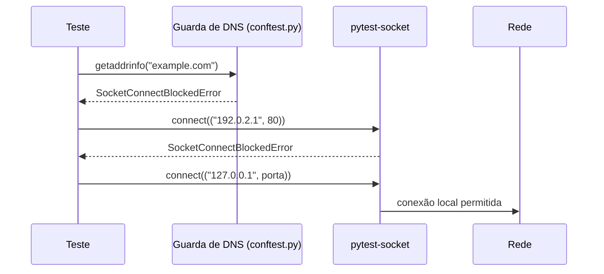
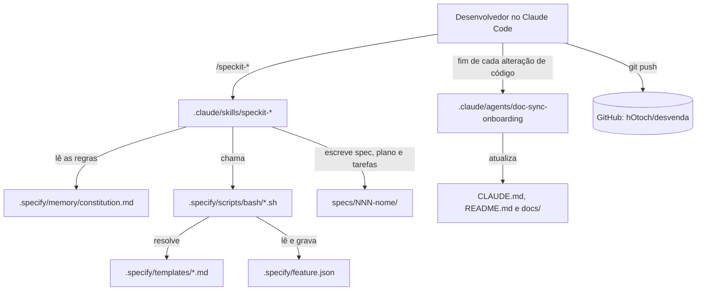
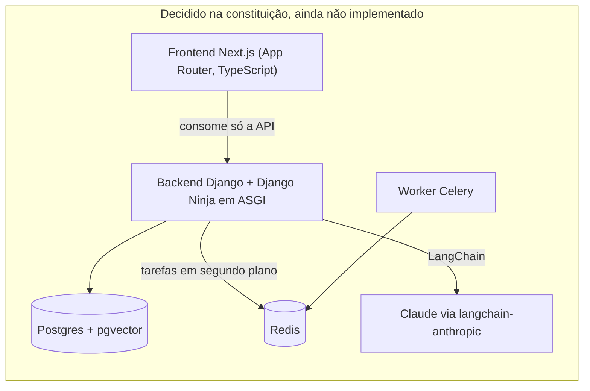
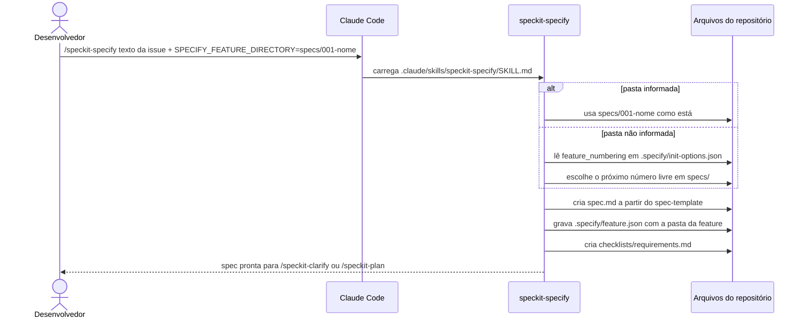

# Arquitetura

## Visão geral

Imagine um terreno onde vai ser construída uma casa. Hoje ainda não há paredes, mas já existem três coisas: o **código de obras** (as regras que toda construção precisa seguir), o **processo de aprovação** de cada cômodo (ninguém levanta uma parede sem planta aprovada) e a **planta geral** (quais materiais e que tipo de casa será).

No Desvenda é igual:

- o código de obras é a [constituição](../.specify/memory/constitution.md);
- o processo de aprovação é o spec-kit, que transforma cada issue numa especificação, num plano e numa lista de tarefas antes de qualquer código;
- a planta geral é a lista de tecnologias decididas na constituição, que ainda não foram instaladas.

Quando o código de aplicação chegar, este documento passa a descrever o sistema rodando: módulos, requisições, banco e infraestrutura.

## O que existe hoje

| Caminho | Papel |
|---|---|
| `.specify/memory/constitution.md` | Regras do projeto (princípios I a VIII), tecnologias decididas e fluxo de desenvolvimento |
| `.specify/templates/` | Modelos de spec, plano, tarefas, checklist e constituição |
| `.specify/scripts/bash/` | Scripts que criam a pasta da feature, localizam a feature atual e resolvem os modelos |
| `.specify/workflows/speckit/workflow.yml` | Fluxo automático do spec-kit (specify → plan → tasks → implement com revisões) |
| `.specify/init-options.json`, `.specify/integration.json` | Configuração com que o spec-kit foi instalado |
| `.specify/integrations/*.manifest.json` | Hash de cada arquivo instalado pelo spec-kit, usado nas atualizações |
| `.claude/skills/speckit-*/SKILL.md` | Os comandos `/speckit-*` do Claude Code |
| `.claude/agents/doc-sync-onboarding.md` | Agente que atualiza `CLAUDE.md`, `README.md` e `docs/` no fim de cada alteração de código ([workflow.md](workflow.md#a-sincronização-da-documentação)) |
| `CLAUDE.md` | Instruções para o agente que implementa o projeto, inclusive a regra que obriga a rodar o `doc-sync-onboarding` |
| `README.md`, `docs/` | Documentação |
| `.gitignore`, `.gitattributes` | Arquivos ignorados e finais de linha LF |
| `backend/` | Projeto Python do uv, ainda sem código de aplicação: só as ferramentas de desenvolvimento (detalhes abaixo, em "Ferramentas do backend") |
| `frontend/README.md` | Pasta reservada para o Next.js, que chega no M4 (#26) |
| `.pre-commit-config.yaml` | Gancho que roda o ruff do backend antes de cada commit |
| `specs/NNN-nome/` | Spec, plano, decisões e tarefas de cada issue (a primeira é `specs/001-monorepo-ferramentas/`) |

Não existem Django, banco, Dockerfile, CI nem scripts de deploy.

### Ferramentas do backend

Pense numa bancada de oficina montada antes da primeira peça: as ferramentas estão no lugar, todas da mesma marca e modelo em qualquer bancada (o `uv.lock`), com uma trava que impede a máquina de ligar para fora durante os testes e um inspetor que confere o acabamento antes de cada entrega (o gancho de commit).

| Ferramenta | Papel | Onde é configurada |
|---|---|---|
| uv | Instala o Python 3.12 e as ferramentas nas versões travadas | `backend/pyproject.toml` (grupo `dev`), `backend/uv.lock`, `backend/.python-version` |
| pytest | Roda os testes de `backend/tests/` | `[tool.pytest.ini_options]` em `backend/pyproject.toml` |
| pytest-cov | Imprime a cobertura de linhas no fim de toda execução | `addopts` e `[tool.coverage.run]` em `backend/pyproject.toml` |
| pytest-socket | Barra todo `connect` fora de `127.0.0.1`, `::1` e `localhost` | `--allow-hosts` em `addopts` |
| guarda de DNS | Barra a consulta de nomes fora da mesma lista, que o pytest-socket não cobre | fixture `bloqueia_consulta_de_nome_externo` em `backend/conftest.py:12` |
| ruff | Verifica padrão (regras `E`, `F`, `W`, `I`, `UP`, `B`) e formatação, linhas de até 100 colunas | `[tool.ruff]` em `backend/pyproject.toml` |
| pre-commit | Roda `ruff check --fix` e `ruff format` antes de cada commit, só em `backend/**/*.py` | `.pre-commit-config.yaml` |

As decisões e as alternativas descartadas estão em `specs/001-monorepo-ferramentas/research.md`.

## Mapa dos módulos

Hoje existe um único módulo: as ferramentas de SDD, documentadas em [apps/speckit.md](apps/speckit.md). Ao lado delas fica o agente de documentação, descrito em [workflow.md](workflow.md#a-sincronização-da-documentação).

### Arquitetura decidida (ainda não implementada)

A constituição, na seção "Restrições técnicas", fixa as tecnologias abaixo. Nenhuma delas está instalada. O diagrama mostra só as ligações que a constituição afirma.

| Peça | Decisão | Observação |
|---|---|---|
| Backend | Python 3.12+, Django em ASGI, Django Ninja, pytest, ruff, uv | Regras de negócio e do jogo ficam aqui |
| Dados | Postgres com pgvector; busca textual do Postgres em português | |
| Fila | Celery + Redis | "salvo decisão diferente numa spec" |
| IA | LangChain com Claude; modelo padrão `claude-opus-5-5` | Provedor de embeddings e reranker decididos nas specs deles |
| Frontend | Next.js (App Router, TypeScript) | Só consome a API |
| Repositório | Monorepo com `backend/` e `frontend/`, Conventional Commits, GitHub Actions | |

## Fluxo de uma requisição

Ainda não há servidor, então não há requisição HTTP para descrever. O único caminho que roda hoje é o de um comando do spec-kit. Este é o `/speckit-specify`, que cria a spec de uma issue (detalhes em [workflow.md](workflow.md) e [apps/speckit.md](apps/speckit.md)):

## Middlewares

Nenhum. Não há aplicação web.

## Integrações externas

| Integração | Como está ligada | Situação |
|---|---|---|
| GitHub | Remoto `origin` = `https://github.com/hOtoch/desvenda.git` | Repositório **público**. A `main` foi enviada em 02/11/2026. As issues #1 a #39, os milestones M0 a M15 e as labels foram criados no mesmo dia por um script local que não está no repositório |
| Claude Code | Lê `.claude/skills/`, `.claude/agents/` e `CLAUDE.md` | Executa os comandos `/speckit-*` e o agente `doc-sync-onboarding` |
| Provedores de IA (Claude, embeddings) | Ainda não há código | Decididos na constituição e nas specs |

## Tarefas assíncronas

Nenhuma. A fila (Celery + Redis) está decidida, mas não instalada.

## Configuração por ambiente

Ainda não existem ambientes (desenvolvimento, teste e produção) nem `.env`. A configuração que existe é a das ferramentas.

### Variáveis de ambiente lidas hoje

Todas são do spec-kit e opcionais.

| Variável | Onde é lida | Efeito |
|---|---|---|
| `SPECIFY_FEATURE_DIRECTORY` | `.specify/scripts/bash/common.sh:192` e `.claude/skills/speckit-specify/SKILL.md:84` | Pasta da feature atual. Tem prioridade sobre `.specify/feature.json` e é gravada nele |
| `SPECIFY_FEATURE` | `.specify/scripts/bash/common.sh:80` | Nome da feature atual (sai como `CURRENT_BRANCH`) |
| `SPECIFY_FEATURE_NO_PERSIST` | `.specify/scripts/bash/common.sh:176` e `.specify/scripts/bash/create-new-feature.sh:465` | Com `1` ou `true`, nenhum script grava `.specify/feature.json` |
| `SPECIFY_INIT_DIR` | `.specify/scripts/bash/common.sh:58` | Força a raiz do projeto, em vez de procurar a pasta `.specify/` |

### Arquivos de configuração

| Arquivo | Conteúdo relevante |
|---|---|
| `.specify/init-options.json` | `integration: claude`, `script: sh`, `feature_numbering: sequential`, `speckit_version: 1.1.1.dev0` |
| `.specify/integration.json` | Integração `claude` com separador `-` (por isso os comandos são `/speckit-specify`, não `/speckit.specify`) |
| `.specify/.gitignore` | Ignora `feature.json` (estado local de cada cópia do repositório) |
| `.gitattributes` | `* text=auto eol=lf`: sem isso, o Git no Windows grava CRLF e os scripts bash quebram |
| `.git/config` (não versionado) | Identidade dos commits: `Hugo Otoch <71613053+hOtoch@users.noreply.github.com>` |
| `backend/pyproject.toml` | Projeto `desvenda-backend`, `requires-python = ">=3.12"`, `package = false` (aplicação, não biblioteca), grupo `dev` com as ferramentas e a configuração do pytest, da cobertura e do ruff |
| `backend/uv.lock` | Versões exatas de tudo; `uv sync --locked` falha se ele divergir do `pyproject.toml` |
| `backend/.python-version` | `3.12`: a versão que o uv usa ou baixa |
| `.pre-commit-config.yaml` | Ganchos `repo: local` que chamam `uv run --project backend ruff ...`, para o commit usar o mesmo ruff do `uv.lock` |
| `.git/hooks/pre-commit` (não versionado) | Criado por `uv run --project backend pre-commit install`, uma vez por cópia |

## Infraestrutura de produção

Nenhuma. Não há deploy, servidor, banco nem domínio. O plano de trabalho no GitHub coloca o deploy no milestone M6, na issue #38.

## Pegadinhas e dívidas técnicas

| # | Problema | Consequência | O que fazer |
|---|---|---|---|
| 1 | O repositório no GitHub é público e já recebeu a `main` | Código, constituição e issues ficam visíveis para todos | Nunca versionar segredos nem dados pessoais (Princípio V) |
| 2 | A identidade dos commits está em `.git/config`, que não é versionado | Num clone novo, os commits saem com a identidade global da máquina (neste PC, a do trabalho) | Rodar `git config --local user.name` e `user.email` em cada clone |
| 3 | Ainda não existe CI | Os portões de qualidade da constituição dependem só da revisão humana | Resolvido quando o CI do milestone M0 chegar |
| 4 | A CLI `specify` não faz parte do projeto: foi rodada de outro projeto, na versão de desenvolvimento `1.1.1.dev0` | Não há caminho definido para atualizar o spec-kit | Instalar a CLI quando for preciso atualizar e registrar a versão |
| 5 | O `/speckit-specify` numera as specs sozinho e não cria branch | Sem cuidado, a spec e a branch saem com número diferente do da issue | Seguir [workflow.md](workflow.md); detalhes em [apps/speckit.md](apps/speckit.md#pegadinhas-e-dívidas-técnicas) |
| 6 | O modelo de tarefas diz que testes são opcionais (`.specify/templates/tasks-template.md:12`) | Contradiz o TDD obrigatório da constituição | Ver [apps/speckit.md](apps/speckit.md#pegadinhas-e-dívidas-técnicas) |
| 7 | O script que criou as issues #1 a #39 numera em sequência e para se o número do GitHub não bater | Issues e PRs dividem a numeração no GitHub; com PRs abertos, o script não serve para criar as issues dos milestones M7 a M15 | Criar essas issues de outro jeito, conferindo o número de cada uma antes de criar a branch |
| 8 | O pytest-socket emite um `UserWarning` a cada bloqueio, e no bloqueio da guarda de DNS a mensagem diz `socket.socket.connect()`, embora quem foi barrado seja o `getaddrinfo` (`backend/conftest.py:22`) | A saída dos testes mostra avisos que parecem erro, e a mensagem do DNS engana | Ler o `host` da mensagem; filtrar o aviso só se ele passar a atrapalhar |
| 9 | O `backend/conftest.py` fica na raiz do backend, não em `tests/`, porque a cobertura omite `tests/*` | Hoje ele é o único arquivo medido (100%), então o número da cobertura ainda não diz nada sobre código de aplicação | Nada a fazer: o número passa a importar com o Django (#2) e o mínimo de 90% com o fatiamento (#8) |
| 10 | O gancho de commit precisa ser instalado em cada cópia e pode ser pulado com `git commit --no-verify` | Código fora do padrão pode chegar ao PR | O CI (#4) vai rodar as mesmas verificações; até lá, a revisão confere |
| 11 | A issue #1 lista o pytest-django, mas ele ficou para a #2 (`specs/001-monorepo-ferramentas/research.md`, decisão D8) | Quem ler só a issue espera encontrá-lo | Instalar junto com o Django, na #2 |
