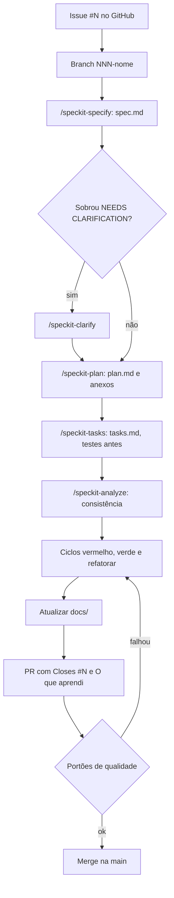

# Fluxo de desenvolvimento

## Visão geral

Pense numa cozinha de restaurante que não improvisa. Cada pedido (a **issue**) primeiro vira uma ficha dizendo o que o cliente quer e por quê (a **spec**). Depois o chef decide como vai preparar (o **plano**) e quebra o preparo em passos (as **tarefas**). Antes de cozinhar cada passo, ele escreve como vai provar que ficou certo (o **teste**), e só então cozinha. No fim, o prato vai para a mesa com a ficha anexada (o **pull request**).

No Desvenda, toda mudança passa por esse caminho. Isso deixa cada decisão registrada, cada comportamento provado por um teste e cada passo pequeno o bastante para ser acompanhado. As regras vêm da [constituição](../.specify/memory/constitution.md): Princípios I (SDD), II (TDD) e VIII (documentação viva), e a seção "Fluxo de desenvolvimento e portões de qualidade".

## O ciclo de uma issue

## Passo a passo

O exemplo usa a issue #1, "Monorepo e ferramentas do backend". NNN é o número da issue com três dígitos.

| # | Passo | Comando ou ação | Resultado |
|---|---|---|---|
| 1 | Pegar a próxima issue do milestone atual | GitHub | Número e texto da issue |
| 2 | Criar a branch | `git switch -c 001-monorepo-ferramentas` | Branch com o número da issue |
| 3 | Especificar | `/speckit-specify <texto da issue> SPECIFY_FEATURE_DIRECTORY=specs/001-monorepo-ferramentas` | `specs/001-monorepo-ferramentas/spec.md`, `checklists/requirements.md` e `.specify/feature.json` |
| 4 | Esclarecer, se preciso | `/speckit-clarify` | Respostas gravadas na spec |
| 5 | Planejar | `/speckit-plan` | `plan.md` e, quando fizer sentido, `research.md`, `data-model.md`, `contracts/` e `quickstart.md` |
| 6 | Quebrar em tarefas | `/speckit-tasks` | `tasks.md`, com uma tarefa de teste antes de cada tarefa que muda comportamento |
| 7 | Conferir | `/speckit-analyze` | Relatório de inconsistências entre spec, plano e tarefas (não altera arquivos) |
| 8 | Implementar | TDD, tarefa por tarefa | Commits `test:`, `feat:`/`fix:` e `refactor:` |
| 9 | Documentar | Editar `docs/` | Documentos atualizados no mesmo PR |
| 10 | Abrir o PR | GitHub | PR com `Closes #1` |

### Por que a branch e a pasta da spec são passos separados

O `/speckit-specify` não cria branch nem aceita `--number`. Sem `SPECIFY_FEATURE_DIRECTORY`, ele escolhe o próximo número livre em `specs/` (`.claude/skills/speckit-specify/SKILL.md:89-92`), que só coincide com o número da issue se as issues forem feitas exatamente em ordem. A criação de branch existe apenas como gancho da extensão `git` do spec-kit (`.claude/skills/speckit-specify/SKILL.md:281`), que não está instalada. Por isso a branch é criada à mão e a pasta é passada explicitamente.

## Artefatos de cada feature

Tudo fica em `specs/NNN-nome/`. Os caminhos são montados por `get_feature_paths` (`.specify/scripts/bash/common.sh:163`).

| Arquivo | Criado por | Conteúdo |
|---|---|---|
| `spec.md` | `/speckit-specify` | O quê e o porquê, sem tecnologia: histórias de usuário com prioridade, requisitos e critérios de sucesso |
| `checklists/requirements.md` | `/speckit-specify` | Checklist de qualidade da própria spec |
| `plan.md` | `/speckit-plan` (o modelo é copiado por `setup-plan.sh`) | Contexto técnico, Constitution Check, estrutura de pastas e Complexity Tracking |
| `research.md` | `/speckit-plan`, quando necessário | Pesquisa e decisões técnicas |
| `data-model.md` | `/speckit-plan`, quando necessário | Entidades e campos |
| `contracts/` | `/speckit-plan`, quando necessário | Contratos de API |
| `quickstart.md` | `/speckit-plan`, quando necessário | Como validar a feature à mão |
| `tasks.md` | `/speckit-tasks` | Tarefas numeradas (`T001`…), com as fases Setup, Foundational, uma por história e Polish |

## TDD na prática

1. Escolha a próxima tarefa de teste em `tasks.md`.
2. Escreva o teste e rode-o: ele precisa **falhar pelo motivo certo** (a funcionalidade não existe, não um erro de digitação).
3. Commit `test: ...` com o teste falhando.
4. Escreva o mínimo de código para o teste passar. Commit `feat: ...` ou `fix: ...`.
5. Melhore o código com os testes verdes. Commit `refactor: ...`, se houver.
6. Marque a tarefa em `tasks.md` e siga para a próxima.

Regras complementares da constituição:

- LLM, embeddings, reranker e serviços externos ficam atrás de interfaces, com versões falsas e determinísticas nos testes. Os testes não usam rede (Princípio III).
- Testes contra provedores reais levam `@pytest.mark.llm` e nunca bloqueiam um PR.
- Os módulos de lógica pura têm pelo menos 90% de cobertura (Princípio II).
- Mudanças de busca, prompt, modelo ou agente mostram as métricas de avaliação antes e depois (Princípio IV).

## O pull request

| Seção | O que contém |
|---|---|
| Título | Conventional Commits, por exemplo `feat: monorepo e ferramentas do backend` |
| Descrição | O que mudou e por quê, com link para `specs/NNN-nome/spec.md` |
| `Closes #N` | Fecha a issue no merge |
| Avaliações | Métricas antes e depois, quando a mudança afeta a IA |
| Documentação | Quais arquivos de `docs/` mudaram |
| **O que aprendi** | Conceitos, erros e referências |

## Portões de qualidade

O merge exige:

- CI verde: ruff, testes, cobertura dos módulos de lógica pura e avaliação da busca quando ela é afetada. **O CI ainda não existe**; até ele chegar, a revisão confere à mão;
- todas as tarefas de `tasks.md` marcadas;
- `docs/` atualizada;
- a constituição conferida na revisão.

## Exceções

Não precisam de spec: correção de texto, atualização de dependência sem mudança de comportamento e ajuste de configuração de CI (Princípio I). Esses casos ainda exigem issue e PR.

Os commits iniciais do repositório (spec-kit, constituição, finais de linha e esta documentação) foram feitos direto na `main`, antes de existirem issues no GitHub.

## Pegadinhas e dívidas técnicas

| # | Problema | Como evitar |
|---|---|---|
| 1 | `/speckit-specify` ignora o número da issue se `SPECIFY_FEATURE_DIRECTORY` não for passado | Sempre passar `SPECIFY_FEATURE_DIRECTORY=specs/NNN-nome` |
| 2 | A branch não é criada por nenhum comando | `git switch -c NNN-nome` antes de especificar |
| 3 | `.specify/feature.json` aponta para a última feature especificada e não acompanha a troca de branch | Depois de trocar de branch, reexportar `SPECIFY_FEATURE_DIRECTORY` antes de `/speckit-plan` ou `/speckit-tasks` |
| 4 | O modelo de tarefas diz que testes são opcionais | A constituição prevalece; conferir em `/speckit-analyze` que há teste antes de cada implementação |
| 5 | A constituição v1.0.0 mandava usar `--number` no `/speckit-specify` | Corrigido na v1.1.0 |

Os detalhes técnicos de cada item estão em [apps/speckit.md](apps/speckit.md).
